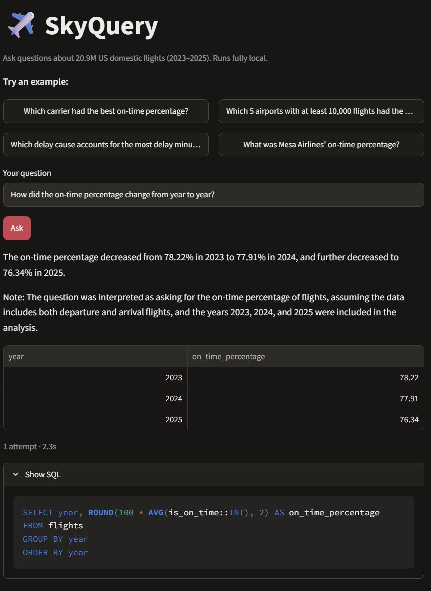
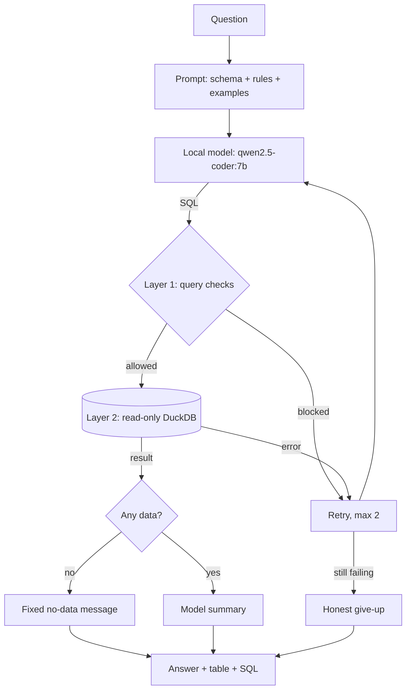
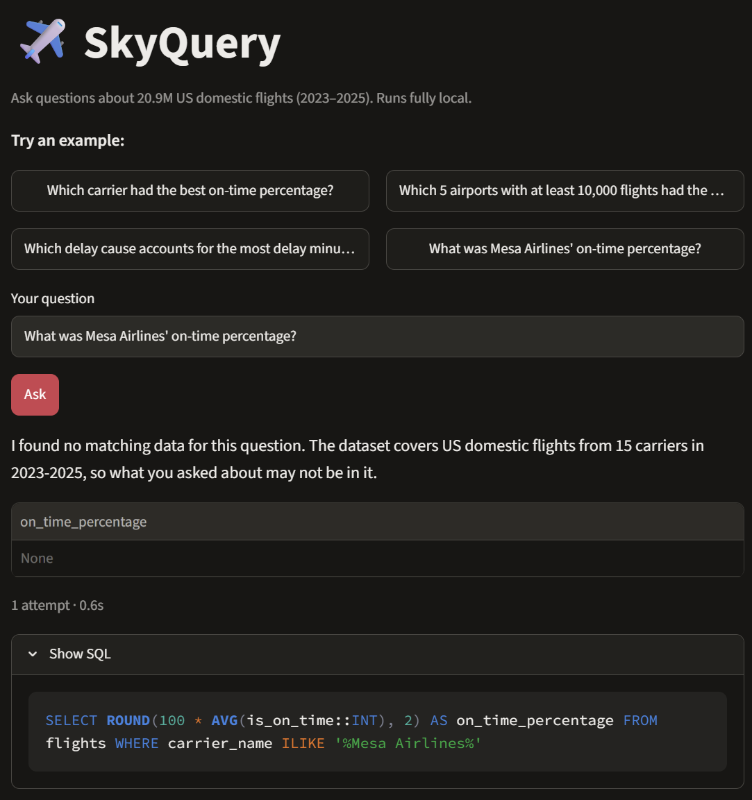

# SkyQuery

A local AI agent that answers plain-English questions about 20.9M US domestic flights (2023–2025) by writing and running SQL.

**Stack:** Ollama (qwen2.5-coder:7b) · DuckDB · Parquet · Python · Streamlit. Free and fully local.



## Why I built this
Most "chat with your data" demos look impressive but are never measured, and language models confidently give wrong answers to data questions. I wanted to find out how accurate a small, free, local model could actually be, and what it takes to make it trustworthy:
- **Measure it:** a verified answer key, a holdout set and a comparison of each layer's effect
- **Make the meaning explicit:** a semantic layer that builds business definitions into the data
- **Make it safe:** two independent layers that stop the agent from changing data or reading other files
- **Make it honest:** it shows its SQL, states its assumptions, and says so when there's no data

## Results

### What each layer adds (28 dev questions)
| Mode | What's added | Score | On-time KPI questions |
|---|---|---|---|
| Raw | Raw columns, one try | 19/28 (68%) | 3/10 |
| Semantic | + clean views + schema guide | 24/28 (86%) | 8/10 |
| Agent | + few-shot examples + retry on error | **27/28 (96%)** | 9/10 |

The raw model handled simple counts but got the main business metric wrong most of the time: wrong delay column, nulls silently dropped, invented formulas. The semantic layer fixed most of this by building the on-time definition into the data.

### Holdout
| Test set | Questions | Score |
|---|---|---|
| Holdout (never used for tuning, run once) | 12 | **12/12 (100%)** |

Caveats: both test sets are small and written by the same author, and holdout questions are mostly simple (one or two filters). Examples and retry are measured together, but retries never rescued a wrong answer in testing, so the gain mostly came from the examples.

## How it works



1. **Prompt:** the question is combined with the schema guide, business rules and five worked examples.
2. **SQL:** the local model (qwen2.5-coder:7b on Ollama, local GPU) writes one SQL query.
3. **Two safety layers:** keyword checks (single SELECT, no file access, 1,000-row limit, 30 s timeout), then a locked-down, read-only DuckDB database that may only read the 20.9M-row Parquet file.
4. **Retry:** if the query is blocked or fails, the error goes back to the model, up to 2 retries. After that, it gives up honestly.
5. **Answer:** if the result has no data, a fixed message is returned in code with no model call. Otherwise, the model summarises using only numbers from the result and states its assumptions.

## Honest when there's no data
Asked about an airline that isn't in the dataset, SkyQuery says so instead of inventing a number:



## Safety
Two independent layers protect the data:

| Layer | How | What it does |
|---|---|---|
| 1. Query checks | `src/sql_tool.py` | Allows only a single SELECT, blocks file-reading functions and paths, trims results to 1,000 rows, stops queries after 30 s |
| 2. Locked-down database | `src/semantic.py` | Read-only, and DuckDB may read **only** `flights.parquet` (`allowed_paths`, external access off, settings locked, 4 GB memory limit). Holds even if layer 1 is bypassed |

Layer 1 is a keyword blocklist, so it can be bypassed: a pre-portfolio code review found four ways around it. Layer 2 is an allowlist enforced by DuckDB itself. `scripts/test_read_only.py` proves it: it creates a real file outside the project, then sends write, read and unlock attempts straight to the database (skipping layer 1), on both a connection and a cursor. All are refused.

## Setup
**Needs:** Python 3.11, [Ollama](https://ollama.com), and ideally an NVIDIA GPU with about 6 GB free VRAM (it also runs on CPU, more slowly). Run all commands from the `skyquery` folder.

1. **Get the model** (Ollama must be running, which it usually does in the background after install):
   ```
   ollama pull qwen2.5-coder:7b
   ```
2. **Clone and install:**
   ```
   git clone https://github.com/hashir-muhmd/skyquery.git
   cd skyquery
   python -m venv .venv
   .venv\Scripts\Activate.ps1        # macOS/Linux: source .venv/bin/activate
   pip install -r requirements.txt
   ```
3. **Get the data:** download the BTS "Reporting Carrier On-Time Performance" monthly CSVs for 2023–2025 (36 files, same columns as the [SkyMetrics](https://github.com/hashir-muhmd/skymetrics) project) from [BTS TranStats](https://www.transtats.bts.gov/), and put them in `data/raw/`. If they're stored somewhere else, set the `SKYQUERY_RAW_DIR` environment variable to that folder instead.
4. **Build the Parquet file:**
   ```
   python scripts/convert_to_parquet.py
   ```
5. **Run it** (`--server.address localhost` keeps the app off your local network):
   ```
   streamlit run app.py --server.address localhost
   ```
   Or from the command line:
   ```
   python -m src.agent "Which 5 airports with at least 10,000 flights had the worst on-time percentage?"
   ```

### Run the evaluation
These need Ollama running:
```
python -m eval.run_eval --mode agent                  # dev set (also: --mode raw, --mode semantic)
python -m eval.run_eval --mode agent --set holdout    # holdout set
```
Note: the holdout result above comes from a single run. Running it again overwrites `eval/results_agent_holdout.json`.

The safety test doesn't need the model:
```
python -m scripts.test_read_only
```

## Progress
- [x] Day 1: Ollama + qwen2.5-coder:7b running on GPU (RTX 5060, ~4.6 GB VRAM)
- [x] Day 1: 36 BTS CSVs converted to one Parquet file (20,928,599 rows, 357 MB, 16 s)
- [x] Day 1: First DuckDB queries matched against SkyMetrics. Found a null-handling bug: SkyMetrics counted cancelled/diverted flights as on-time (79.1% vs correct 77.5%)
- [x] Day 2: Verified answer key (11 questions). Baseline with raw schema only: **2/5 correct (40%)**. Failures were about column meaning and metric definitions, not SQL syntax
- [x] Week 1: Semantic layer (clean view + schema guide). Same 5 questions at temperature 0: **raw 3/5 → semantic 5/5**
- [x] Week 1: Agent loop. Guarded SQL tool (SELECT-only, single statement, no file access, 1,000-row limit, 30 s timeout), retry on error (max 2), grounded plain-English summary that states its assumptions
- [x] Week 2: Answer key grown to 28 questions (filters, trends, delay causes, airports, 4 "no data" questions). Full agent on this dev set: **22/28 → 27/28 (96%)** via general fixes: full carrier list, long-format `delay_causes` view, few-shot examples
- [x] Week 2: Holdout set of 12 new questions, never used for tuning, run once: **12/12**
- [x] Week 2: Comparison table: raw 68% → semantic 86% → agent 96%
- [x] Week 2: Read-only database connection as a second safety layer (dev score unchanged at 27/28)
- [x] Week 3: Streamlit app with example questions, results table, "Show SQL" and attempt count. Found and fixed a summary bug: for "no data" results the model reported "0.00%"; empty results now return a fixed honest message in code
- [x] Week 3: Architecture diagram, setup guide, reproducible data path
- [x] Week 3: Pre-portfolio code review found 4 ways to bypass layer 1 and read other files. Fixed with a DuckDB allowlist in layer 2, proven by tests; dev score unchanged at 27/28
- [x] Week 3: Review clean-up: stricter no-data grading (score unchanged), pinned package versions, early eval files moved to `eval/archive/`

## Known limitations
- The model sometimes uses departure airports (origin) for arrivals questions when combined with rankings and filters (dev q18), despite a rule and an example
- The retry loop fixes SQL errors, not wrong answers: every remaining failure was valid SQL with the wrong meaning
- The eval scores the SQL result, not the summary text. Testing the app found a summary that turned "no data" into "0.00%" (now fixed in code)
- A count of 0 (e.g. flights in 2022) is still summarised by the model, since 0 can be a real answer
- "Departed" and "arrived" count all scheduled flights, including cancelled ones

## Data
US BTS on-time performance data, 2023–2025, from the [SkyMetrics](https://github.com/hashir-muhmd/skymetrics) project. The data files are not stored in this repo; see Setup to build them. `scripts/first_query.py` and `scripts/check_on_time.py` are the Day 1 checks that matched DuckDB against SkyMetrics and found the on-time definition bug.