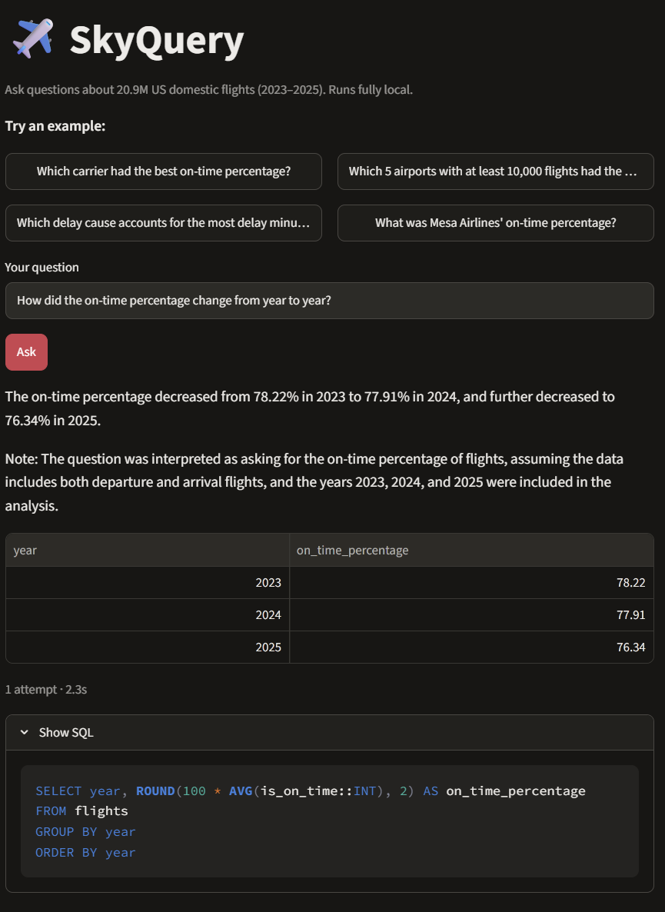
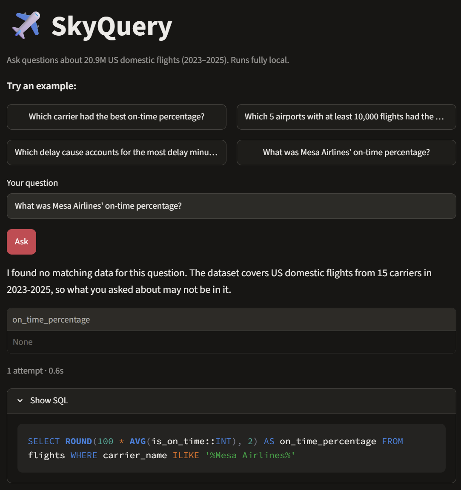

# SkyQuery

A local AI agent that answers plain-English questions about 20.9M US domestic flights (2023–2025) by writing and running SQL.

**Stack:** Ollama (qwen2.5-coder:7b) · DuckDB · Parquet · Python · Streamlit. Free and fully local.



## Results

### What each layer adds (28 dev questions)
| Mode | What's added | Score | On-time KPI questions |
|---|---|---|---|
| Raw | Raw columns, one try | 19/28 (68%) | 3/10 |
| Semantic | + clean views + schema guide | 24/28 (86%) | 8/10 |
| Agent | + few-shot examples + retry on error | **27/28 (96%)** | 9/10 |

The raw model handled simple counts but got the main business metric wrong most of the time: wrong delay column, nulls silently dropped, invented formulas. The semantic layer fixed most of this by building the on-time definition into the data.

### Holdout
| Test set | Questions | Score |
|---|---|---|
| Holdout (never used for tuning, run once) | 12 | **12/12 (100%)** |

Caveats: both test sets are small and written by the same author, and holdout questions are mostly simple (one or two filters). Examples and retry are measured together, but retries never rescued a wrong answer in testing, so the gain mostly came from the examples.

## Honest when there's no data
Asked about an airline that isn't in the dataset, SkyQuery says so instead of inventing a number:



## Safety
Two independent layers protect the data:

| Layer | How | Blocks |
|---|---|---|
| 1. Query checks | `src/sql_tool.py` | Anything but a single SELECT, file-reading functions and paths, results over 1,000 rows, queries over 30 s |
| 2. Read-only database | `src/semantic.py` opens DuckDB with `read_only=True` | Any write (`DROP`, `CREATE`, `INSERT`...), even if layer 1 is bypassed |

`scripts/test_read_only.py` sends harmful SQL straight to the database, skipping layer 1, to prove layer 2 refuses it.

## Try it
Web app:
```
streamlit run app.py
```
Command line:
```
python -m src.agent "Which 5 airports with at least 10,000 flights had the worst on-time percentage?"
```

## Progress
- [x] Day 1: Ollama + qwen2.5-coder:7b running on GPU (RTX 5060, ~4.6 GB VRAM)
- [x] Day 1: 36 BTS CSVs converted to one Parquet file (20,928,599 rows, 357 MB, 16 s)
- [x] Day 1: First DuckDB queries matched against SkyMetrics. Found a null-handling bug: SkyMetrics counted cancelled/diverted flights as on-time (79.1% vs correct 77.5%)
- [x] Day 2: Verified answer key (11 questions). Baseline with raw schema only: **2/5 correct (40%)**. Failures were about column meaning and metric definitions, not SQL syntax
- [x] Week 1: Semantic layer (clean view + schema guide). Same 5 questions at temperature 0: **raw 3/5 → semantic 5/5**
- [x] Week 1: Agent loop. Guarded SQL tool (SELECT-only, single statement, no file access, 1,000-row limit, 30 s timeout), retry on error (max 2), grounded plain-English summary that states its assumptions
- [x] Week 2: Answer key grown to 28 questions (filters, trends, delay causes, airports, 3 "no data" trick questions). Full agent on this dev set: **22/28 → 27/28 (96%)** via general fixes: full carrier list, long-format `delay_causes` view, few-shot examples
- [x] Week 2: Holdout set of 12 new questions, never used for tuning, run once: **12/12**
- [x] Week 2: Comparison table: raw 68% → semantic 86% → agent 96%
- [x] Week 2: Read-only database connection as a second safety layer (dev score unchanged at 27/28)
- [x] Week 3: Streamlit app with example questions, results table, "Show SQL" and attempt count. Found and fixed a summary bug: for "no data" results the model reported "0.00%"; empty results now return a fixed honest message in code
- [ ] Week 3: Architecture diagram, demo video, final README

## Known limitations
- The model sometimes uses departure airports (origin) for arrivals questions when combined with rankings and filters (dev q18), despite a rule and an example
- The retry loop fixes SQL errors, not wrong answers: every remaining failure was valid SQL with the wrong meaning
- The eval scores the SQL result, not the summary text. Testing the app found a summary that turned "no data" into "0.00%" (now fixed in code)
- A count of 0 (e.g. flights in 2022) is still summarised by the model, since 0 can be a real answer
- "Departed" and "arrived" count all scheduled flights, including cancelled ones

## Data
US BTS on-time performance data, 2023–2025, from the [SkyMetrics](https://github.com/hashir-muhmd/skymetrics) project. The data file is not stored in this repo. Run `scripts/convert_to_parquet.py` to build it.